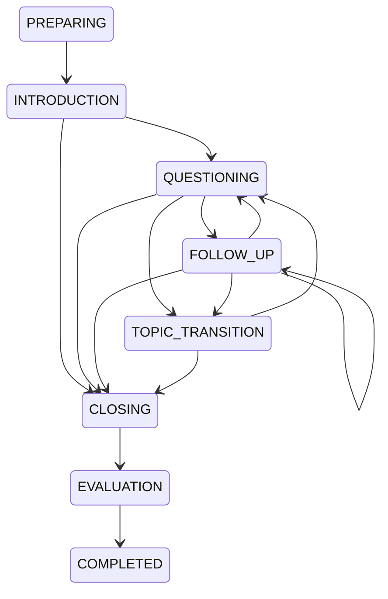

# Stateful interview API

The existing MongoDB authentication remains in use. Every route below requires the current bearer token. Session lookup, report lookup, history and deletion always include the authenticated owner's ID. Missing resources and other users' sessions return the same 404 response.

Base path: `/api/interview/sessions`. Shared input/output types are in `src/lib/interviewTypes.ts`.

| Method | Path | Request | Response |
|---|---|---|---|
| POST | `/` | `{config: InterviewConfig}` | `201 {session}` in PREPARING |
| GET | `/` | `?limit=20&before=<nextCursor>` | `{sessions,nextCursor}`; newest creation first; limit 1–50 |
| GET | `/:id` | — | `{session}` including transcript and remaining time |
| POST | `/:id/start` | `{requestId,expectedVersion}` | `{session}` in INTRODUCTION |
| POST | `/:id/messages` | `{requestId,expectedVersion,questionId,text}` | `{session}` with saved answer and validated next question |
| POST | `/:id/complete` | `{requestId,expectedVersion}` | `{session}` in COMPLETED with report |
| POST | `/:id/resume` | `{expectedVersion}` | `{session}`; does not extend the deadline |
| POST | `/:id/cancel` | — | `{session}`; stops an in-flight operation and preserves saved answers |
| GET | `/:id/report` | — | `{report}`; 409 while no report exists |
| DELETE | `/:id` | — | 204; removes this session, transcript, evidence and report |

Configuration supports technical, HR, behavioral, resume, project, system design, coding and mixed modes. Inputs include target role, experience level, domain, difficulty and a 5–60 minute duration. Resume text is optional and limited to 16,000 characters; job description text is limited to 8,000. Answer input is limited to 12,000 characters. These fields are data, never privileged model instructions.

Mutations use a client-generated stable `requestId` (UUID is suitable) and the last observed session `version`. On failure, refresh the session, reuse the original request ID, question ID and answer text, and send its new version. An accepted answer is saved before the AI call. `pendingAnswer` identifies that saved turn for resumption. Repeating a completed request returns the current saved session without another AI call. Reusing its ID with different answer text or another action returns 409. A stale version or another in-flight mutation also returns 409.

State transitions are enforced server-side:



The wall-clock deadline begins when the first validated introductory question is saved. Failed initial preparation does not consume interview time. Resuming and retrying after the introduction keep that deadline. A maximum of 50 candidate answers and 256 distinct mutation request IDs bounds stored session growth; retries of an existing ID remain possible. At the time or answer limit the engine requests a closing message. If time expires during a generated question, it retains the answer and returns `DEADLINE_REACHED`; the candidate can finish and generate a report. There are at most two consecutive follow-ups before another primary question or topic transition.

## Streaming

For start, message and complete requests, `Accept: text/event-stream` enables SSE. Normal JSON remains supported, including idempotent replay. Heartbeat comments maintain the connection while a provider request runs.

```text
event: status
data: {"state":"QUESTIONING","message":"Generating a contextual interview question."}

event: delta
data: {"text":"How did you handle JWT expiration","provisional":true}

event: session
data: {"session":{...}}
```

`delta.text` replaces the previous preview: it is cumulative provisional utterance text, extracted from the actual provider's streaming JSON. It must not be treated as saved transcript or spoken aloud before the final validated `session` event. Full AI response validation precedes persistence and final delivery. Only the final interviewer turn enters the transcript and playback queue. An SSE `error` event contains `{error,code,retryable}` and ends the response; earlier previews must be discarded.

The Groq adapter uses JSON Object Mode and server-side validation for both streamed and non-streamed completions. It does not combine streaming with strict JSON Schema mode, which [Groq's structured output documentation](https://console.groq.com/docs/structured-outputs) currently says is unsupported. The default conversational model is `openai/gpt-oss-120b`, listed in [Groq's current supported models](https://console.groq.com/docs/models). A real account's model permissions still require credentialed verification.

## Evidence and memory

Follow-ups cite an exact substring of the latest saved candidate turn and must explicitly refer to a term in that quote. Repeated questions and invalid or abrupt difficulty changes are rejected. Compact factual memory retains covered topics, candidate claims, follow-up opportunities, current difficulty and a bounded summary; the provider receives the latest three answers, bounded resume/job excerpts and a bounded question history rather than the entire transcript on every turn.

Reports assess technical accuracy, reasoning, communication clarity, relevance, completeness, problem solving and confidence supported by the candidate's words. Every scored dimension and every strength or improvement must cite a candidate turn ID with an exact quote present in the saved transcript. Fabricated, other-speaker and interviewer quotes are rejected. Unobserved dimensions may use null scores with an explanation. Overall score is the unweighted mean of observed dimension scores. Evidence validation verifies source identity and exact text; the semantic quality of AI assessment still requires live evaluation. No camera or acoustic metric is supplied to the report evaluator.

Evaluation sends at most one 1,200 character excerpt per candidate answer and identifies truncation; the complete original submitted answers remain available in storage. Reports disclose transcript-only limitations and do not claim measured personality, honesty, emotion, body language or voice-based confidence. Failed evaluation remains in EVALUATION with no report, allowing retry.

## Provider and storage

`backend/ai/provider.ts` exposes `createAIProvider()` with `completeJson()` and `transcribe()`. Groq is the default, with compatible OpenAI/LiteLLM and Ollama chat adapters for existing deployments. Groq SDK requests have bounded retries, a per-attempt timeout, a total abortable deadline, token usage collection, and local concurrency protection. The server's MongoDB middleware provides shared API abuse limits. Abort and timeout errors have distinct safe error codes. Only failure classification is logged; private provider responses, transcripts and credentials are not logged by this module.

Environment controls: `AI_PROVIDER`, `GROQ_API_KEY`, `GROQ_MODEL`, optional `GROQ_MODEL_CHAT`/`GROQ_MODEL_REPORT`, `GROQ_STT_MODEL`, `AI_REQUEST_TIMEOUT_MS` (default 60,000, allowed 1,000–120,000), `AI_MAX_CONCURRENT_REQUESTS` (default 6, allowed 1–32), and existing compatible-provider configuration. Credentials remain on the server. The Groq STT default is `whisper-large-v3-turbo`; optional `LOCAL_STT_URL` remains a fallback when no Groq key exists.

The additive `interview_sessions` MongoDB collection stores owner ID, schema version, typed session payload, actual submitted turns, actual validated AI output, idempotency records and an expiring mutation lease. Claims and saves are atomic MongoDB operations. Cancelling removes the lease, so even a delayed result from another process cannot overwrite the saved session. Cancellation aborts active requests on the current process; requests on other processes remain bounded by provider timeout and cannot commit without their original lease. Existing collections and historical metadata are preserved. Deletion removes the dedicated session's private data, and automatically cancels any local active request.

## Validation status

`tests/interview.engine.test.ts` checks state transitions, configuration, follow-up grounding, bounded context, evidence validation, partial streaming extraction and deadlines. `tests/interview.routes.test.ts` exercises Express routes against an actual ephemeral MongoDB database, using explicitly synthetic AI fixtures: persistence reload, history, authorized deletion, answer retry idempotency, ownership, version conflicts, SSE, cancellation and report failure/retry. `tests/aiProvider.test.ts` exercises provider transport through a localhost HTTP/SSE fixture, including retry, usage, timeout/cancellation, redaction and upload validation. These are not evidence of successful live Groq chat, speech recognition, or human listening evaluation; those require configured credentials.
